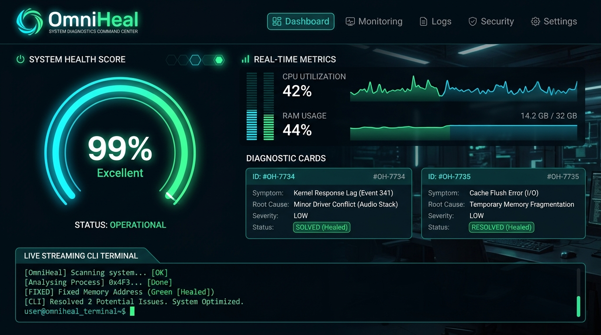
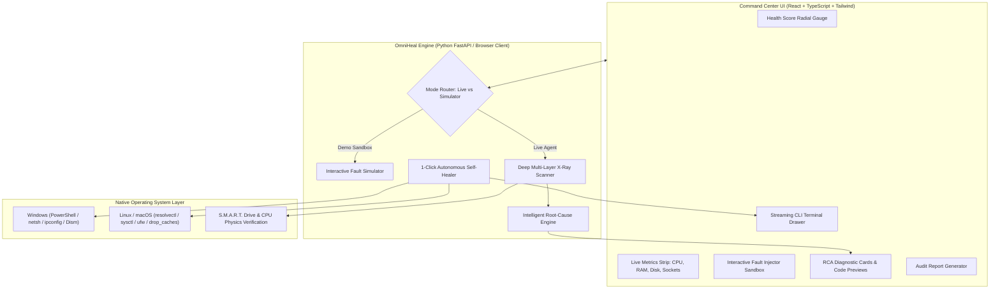

# OmniHeal™ — Autonomous Endpoint Diagnostics & 1-Click Self-Healing Engine

[](https://github.com/hacker71185/omniheal)
[](https://github.com/hacker71185)
[](LICENSE)
[](https://github.com/hacker71185/omniheal)

> **Architected & Designed by [hacker71185](https://github.com/hacker71185)**  
> *Autonomous Endpoint Diagnostics, S.M.A.R.T. Hardware Triage & 1-Click Self-Healing Engine*



**OmniHeal™** is an enterprise-grade autonomous endpoint diagnostic and 1-click self-healing engine. It detects and automatically resolves non-physical PC and laptop bottlenecks, network blackouts, memory leaks, bloated caches, and security misconfigurations in real time.

Designed for IT operations teams, system administrators, and tech professionals, OmniHeal delivers real-time root-cause analysis (RCA), non-destructive remediation scripting, before/after telemetry progression, and a live streaming CLI terminal inside an ultra-modern dark cyber diagnostics command center.

---

## 💻 1-Command Shell Quick-Start (Terminal / Shell Interface)

OmniHeal can be installed and run **entirely inside any terminal shell** (PowerShell, Windows CMD, Bash, or Zsh) with zero browser requirements:

### Option A: Install directly via pip from GitHub
```bash
pip install git+https://github.com/hacker71185/omniheal.git
omniheal
```

### Option B: Clone & run interactive shell directly
```bash
git clone https://github.com/hacker71185/omniheal.git
cd omniheal
pip install -r backend/requirements.txt
python cli.py
```

### CLI Command Flags & Scripting Automation
OmniHeal CLI supports headless script execution for automated IT operations, CI pipelines, and endpoint maintenance:

```bash
# Run deep diagnostic scan and output telemetry to shell
python cli.py --scan

# 1-Click Heal all detected issues with streaming live logs
python cli.py --heal

# Dry-Run mode: Preview all remediation commands without executing
python cli.py --heal --dry-run

# Inject and test simulated fault scenario in terminal
python cli.py --simulate dns_blackout --heal

# Export complete Markdown audit report to file
python cli.py --report audit.md

# Output raw JSON telemetry for monitoring pipelines
python cli.py --scan --json

# Launch the full-stack web UI dashboard & backend daemon
python cli.py --web
```

---

## Architecture & System Flow

OmniHeal operates with a decoupled **Dual-Mode Architecture**:

1. **Live Host Agent Mode:** Connects to the local Python FastAPI agent (`127.0.0.1:8765`), utilizing `psutil`, native PowerShell/CMD execution wrappers on Windows, and Bash on Linux/macOS to diagnose the host OS and execute verified safe repairs.
2. **Interactive Simulator / Demo Mode:** Provides a zero-dependency portfolio and recruiter sandbox where users can inject realistic fault scenarios ("No-Internet DNS Blackout", "Slow Boot & RAM Leak", "Malware Hosts Hijack") and watch the autonomous self-healer detect root causes and heal the system in real time.



---

## Core Capabilities & Feature Matrix

### 1. Deep Multi-Layer System Scanner (The "X-Ray" Engine)

OmniHeal inspects four critical OS layers simultaneously:

| Subsystem | Inspected Vectors | Diagnostic Thresholds & Checks |
| :--- | :--- | :--- |
| **Performance & Memory** | Runaway threads, zombie processes, RAM exhaustion, svchost bloat | Evaluates `psutil` process states (`STATUS_ZOMBIE`), unreleased working sets (>1.5 GB), thread locks (>75% CPU load), and service thread count (>280). |
| **Network & Connectivity** | DNS resolution failures, Winsock stack corruption, ephemeral port exhaustion, rogue proxies | Tests UDP/TCP socket connect to primary resolvers (`1.1.1.1:53`), DNS latency, TIME_WAIT socket pooling, and registry proxy hijacks (`ProxyEnable=1`). |
| **Storage & OS Integrity** | Cache bloat, Windows Update locks, disk headroom, S.M.A.R.T. health | Scans `%TEMP%` and `SoftwareDistribution\Download` staging volumes, evaluates component store health, and verifies drive controller physics. |
| **Security & Access** | Modified `hosts` file, disabled firewall profiles, rogue listening ports | Scans for malicious loopback diversions, verifies Domain/Private/Public firewall profiles (`netsh advfirewall`), and flags unauthorized listeners (ports 4444, 5555, 6666, 31337). |

---

### 2. Intelligent Root-Cause Analysis (RCA) Breakdown

Instead of ambiguous Windows error codes (e.g. `0x80070002`), OmniHeal presents an executive diagnostic card for each detected fault:

```
┌────────────────────────────────────────────────────────────────────────┐
│ [NETWORK]  [CRITICAL]  [100% NON-PHYSICAL / SOFTWARE-SOLVABLE]         │
│                                                                        │
│ Title: DNS Resolver Cache Corruption & Socket Desynchronization        │
│                                                                        │
│ ⚠️ Symptom:                                                            │
│ Internet connected to Wi-Fi/LAN, but websites fail to load            │
│ (ERR_NAME_NOT_RESOLVED).                                               │
│                                                                        │
│ 🔧 Technical Root Cause:                                               │
│ Stale recursive DNS resolver cache holding invalid TTL records &       │
│ desynchronized Winsock catalog entries.                                │
│                                                                        │
│ 🛡️ Hardware Verdict:                                                  │
│ Wi-Fi adapter physical MAC/PHY chips verified operational.             │
│ Root cause is 100% algorithmic / software-based.                       │
│                                                                        │
│ 💻 Preview Fix Script (PowerShell):                                    │
│   $ ipconfig /flushdns                                                 │
│   $ ipconfig /registerdns                                              │
│   $ netsh winsock reset                                                │
│                                                                        │
│ [ AUTO-FIX NOW ]                                                       │
└────────────────────────────────────────────────────────────────────────┘
```

---

### 3. Physical Hardware S.M.A.R.T. Triage & Physical Damage Advisor

A common challenge in PC diagnostics is determining whether a slowdown, crash, or freeze is caused by **software/OS bottlenecks** (which OmniHeal heals in 1 click) or **actual physical hardware failure** (which software cannot heal).

OmniHeal queries raw physical controller telemetry (`Get-PhysicalDisk`, CPU frequency dynamic range, RAM address parity lines, battery wear) and provides explicit physical repair advice:

| Physical Component | Controller Diagnostic | Software Verdict | Physical Damage Triage & Repair Suggestions |
| :--- | :--- | :--- | :--- |
| **Storage / NVMe SSD** | Queries S.M.A.R.T. health status and reallocated NAND sectors via Windows Storage API. | **100% HEALTHY:** Software temp bloat or update lock. Reclaimed in 1 click. | **🚨 PHYSICAL DAMAGE / BAD SECTORS:** Drive reporting media degradation.<br>• *Suggestion:* **DO NOT** run intensive `chkdsk /r` (excessive head thrashing destroys failing NAND/platters).<br>• Immediately clone partitions to an external SSD with Clonezilla or Macrium Reflect.<br>• Replace physical M.2 NVMe SSD (loosen chassis screw, insert at 30° angle, tighten standoff). |
| **CPU Thermal & Cooling** | Measures core frequencies under load to detect TjMax clock throttling (<45% base). | **100% HEALTHY:** Dynamic clock scaling active. | **⚠️ THERMAL CLAMP / DRY PASTE:** CPU pinned below base clock to prevent shutdown.<br>• *Suggestion:* Power down, remove chassis cover.<br>• Blast exhaust radiator fins with compressed air (hold fan blade gently).<br>• Clean dried paste with 99% isopropyl alcohol and reapply high-viscosity paste (Arctic MX-4 or Noctua NT-H1). |
| **Physical Memory (RAM)** | Evaluates physical memory address space mapping and parity state. | **100% HEALTHY:** Paging thrashing is purely OS software working-set bloat. | **🚨 MEMORY CHIP FAILURE / ECC BITFLIP:** Unhandled memory parity exceptions.<br>• *Suggestion:* Power down, ground yourself.<br>• Unclip DDR4/DDR5 SO-DIMM sticks, clean gold contacts with isopropyl alcohol wipe, and reseat firmly in alternate slots until latches click.<br>• Run Windows Memory Diagnostic (`Win + R` -> `mdsched.exe`). |
| **Network PHY / Antenna** | Tests PCIe/USB bus descriptor response and RF MAC controller. | **100% HEALTHY:** Winsock/DNS resolver cache corrupt. 1-click flush restores internet. | **⚠️ PHYSICAL DISCONNECT:** WLAN interface dropped off PCIe bus.<br>• *Suggestion:* Verify laptop physical Wi-Fi switch / Fn toggle.<br>• Open casing and verify tiny black/grey coaxial antenna cables are securely snapped onto M.2 card (U.FL IPEX connectors). |
| **Battery / Power Delivery** | Evaluates cycle health and charge capacity (`powercfg /batteryreport`). | **100% HEALTHY:** Normal lithium discharge curve. | **🚨 CHASSIS BULGING / SWELLING:** Battery capacity degraded > 50%.<br>• *Suggestion:* **Fire hazard:** Shut down immediately and disconnect AC adapter.<br>• Do not puncture swollen pouch cells. Replace battery pack with OEM replacement immediately. |

To run the Physical Hardware Advisor in your shell:
```bash
python cli.py --hardware
```
Or click **"Hardware Advisor"** in the web dashboard header.

---

### 4. 1-Click "Fix Everything" Self-Healing Engine

OmniHeal provides both granular **"Auto-Fix Now"** triggers per card and a master **"1-Click Heal All"** button that coordinates multi-threaded remediation:

- **Network Healer:**
  - `ipconfig /flushdns` & `ipconfig /registerdns`
  - `netsh winsock reset`
  - Purges ARP address resolution tables (`arp -d *`)
  - Restores clean Cloudflare (`1.1.1.1`) / Google (`8.8.8.8`) DNS fallbacks
- **Memory & Process Healer:**
  - Trims bloated working sets via `[System.Diagnostics.Process]::EmptyWorkingSet()`
  - Safely reaps orphaned zombie process IDs and releases kernel handles
  - Resets stalled background print spooler (`net stop spooler` -> purge -> `net start spooler`)
  - Consolidates `svchost` worker groups to reduce background thread contention
- **Disk & Storage Healer:**
  - Purges unlocked files in `%TEMP%` and `C:\Windows\Temp` older than 24 hours
  - Stops `wuauserv` & `bits`, cleans locked `SoftwareDistribution\Download` staging deltas, and re-registers the update catalog
  - Reclaims exact megabytes/gigabytes and reports recovered headroom
- **Security & Integrity Healer:**
  - Re-enables Domain, Private, and Public firewall profiles (`netsh advfirewall set allprofiles state on`)
  - Sanitizes the system `hosts` file and rewrites pristine default loopback entries
  - Terminates rogue port listeners and generates inbound blocking rules

---

### 4. Real-Time Streaming CLI Remediation Terminal

The bottom drawer features a resizable, real-time streaming CLI terminal:
- Timestamped telemetry log lines (`HH:MM:SS.mmm`)
- Color-coded severity badges: `[INFO]`, `[WARN]`, `[ERROR]`, `[SUCCESS]`, and `[HEALED]`
- Command preview, module tag (`[NetworkHealer]`, `[CacheHealer]`), and exit code tracking (`exit 0`)
- Auto-scroll, clear log, and fullscreen maximization modes

---

### 5. Interactive Fault Injector (Sandbox & Portfolio Mode)

Click **"Simulate Fault"** in the top navigation bar to trigger realistic scenarios:

1. **No-Internet DNS Blackout & Socket Hijack:** Simulates corrupted DNS resolver cache and exhausted TCP ephemeral socket pool (drops network health to 10%).
2. **Slow Boot, Memory Leak & Zombie Swarm:** Spikes simulated RAM to 93.4% and spawns 18 orphaned worker threads (drops performance score to 15%).
3. **Storage Cache Bloat & Stuck Update Lock:** Generates 12.4 GB of temp/shader bloat and locks Windows Update with error `0x80240034`.
4. **Malware Hosts Hijack & Disabled Firewall:** Disables firewall profiles and redirects security updates in the `hosts` file.
5. **Catastrophic Multi-Layer PC Bottleneck:** Injects faults across all 4 vectors simultaneously, reducing health score to 24%, ready for a dramatic 1-Click Heal demonstration!

---

### 6. Health Progression & Downloadable Audit Report

- **Dynamic Gauge:** Visualizes score transformation (e.g., **38% Critical** -> **99% Optimal**).
- **Audit Report:** Click the document icon in the header to view, copy, or download a full Markdown/PDF diagnostic report including OS telemetry, scan ID, root-cause breakdown, and executed remediation commands.

---

## Quick-Start Guide

### Prerequisites
- **Node.js:** v18+ (tested on Node v24)
- **Python:** 3.10+ (tested on Python 3.14)

---

### 1-Click Launch (Windows)
Double-click `start.bat` in the root directory:
```powershell
.\start.bat
```
This automatically boots the FastAPI agent on `http://127.0.0.1:8765`, starts the React Vite UI on `http://127.0.0.1:5173`, and opens your default browser.

---

### Manual Launch (Windows / Linux / macOS)

#### Terminal 1: Backend Local Agent
```bash
cd backend
python -m pip install -r requirements.txt
python run_agent.py
```
*The local agent will start listening at `http://127.0.0.1:8765`.*

#### Terminal 2: Frontend Command Center
```bash
cd frontend
npm install
npm run dev -- --host 127.0.0.1 --port 5173
```
*Open `http://127.0.0.1:5173` in any modern web browser.*

---

## Safety & Privilege Escalation Notes

### Non-Destructive Guarantee
OmniHeal strictly adheres to a **safe remediation policy**:
- **No data loss:** Temporary files are only cleared from designated cache directories (`%TEMP%`, `C:\Windows\Temp`, `/tmp`). User personal files, downloads, and app configurations are never touched.
- **Rollback safety:** Network resets use standard Windows API catalog re-registration.
- **Component verification:** System file checks verify integrity without overriding user-installed applications.

### Privilege Elevation (Administrator / Sudo)
- OmniHeal automatically checks privilege status upon startup.
- Basic telemetry, RAM working-set trimming, user-level temp cleaning, and demo simulation function in standard user mode.
- System-wide network stack resets (`netsh winsock reset`) and firewall rule modifications require administrative rights. On Windows, right-click PowerShell or CMD and select **"Run as Administrator"** when launching `start.bat`.

---

## API Reference (FastAPI Backend)

| Method | Endpoint | Description |
| :--- | :--- | :--- |
| `GET` | `/api/status` | Returns agent status, OS info, admin privileges, and active mode |
| `GET` | `/api/scan?simulator={bool}` | Executes deep multi-layer scan or generates simulated scan |
| `POST` | `/api/heal` | Remediates specified issues or executes Master 1-Click Heal |
| `GET` | `/api/scenarios` | Lists available synthetic fault scenarios |
| `POST` | `/api/scenarios/inject` | Injects a selected fault scenario into the active session |
| `GET` | `/api/report/markdown` | Generates a full Markdown technical diagnostic audit report |

---

## Project Structure

```
omniheal/
├── backend/
│   ├── app/
│   │   ├── config.py              # Platform detection, admin checks, settings
│   │   ├── models.py              # Pydantic schemas (ScanResult, IssueItem, etc.)
│   │   ├── main.py                # FastAPI endpoints, CORS, state caching
│   │   ├── scanners/
│   │   │   ├── engine.py          # Master scan orchestrator & score calculation
│   │   │   ├── performance.py     # CPU, RAM leaks, zombie processes
│   │   │   ├── network.py         # DNS resolution, socket pool, proxy checks
│   │   │   ├── storage.py         # Temp bloat, update locks, S.M.A.R.T. verdict
│   │   │   └── security.py        # Rogue ports, hosts anomalies, firewall
│   │   ├── remediators/
│   │   │   ├── executor.py        # Safe OS command wrapper (PowerShell/Bash)
│   │   │   ├── network_healer.py  # DNS flush, Winsock reset, ARP clear
│   │   │   ├── memory_healer.py   # Working sets, zombie reaper, spooler reset
│   │   │   ├── cache_healer.py    # Temp purge, shader/browser cache cleanup
│   │   │   └── system_healer.py   # Firewall state, hosts sanitize, port block
│   │   ├── simulator/
│   │   │   └── fault_engine.py    # Interactive fault injection & synthetic telemetry
│   │   └── reports/
│   │       └── report_gen.py      # Technical audit report generator
│   ├── run_agent.py               # Backend daemon entrypoint
│   └── requirements.txt
├── frontend/
│   ├── index.html                 # HTML5 entry with Google Fonts & SEO meta
│   ├── package.json
│   ├── tailwind.config.js         # Cyber IT Diagnostics design system
│   ├── postcss.config.js
│   ├── src/
│   │   ├── types/index.ts         # End-to-end TypeScript interfaces
│   │   ├── services/api.ts        # API client + standalone client-side simulator
│   │   ├── components/
│   │   │   ├── Header.tsx         # Brand, mode toggle, Master Heal button
│   │   │   ├── HealthGauge.tsx    # SVG radial score gauge & subscores
│   │   │   ├── MetricsStrip.tsx   # CPU, RAM, Disk, Sockets telemetry cards
│   │   │   ├── IssueCard.tsx      # Symptom, Root Cause, Verdict, Fix preview
│   │   │   ├── TerminalDrawer.tsx # Real-time streaming CLI console
│   │   │   ├── FaultInjectorModal.tsx # Fault injection sandbox dialog
│   │   │   └── ReportModal.tsx    # Diagnostic Audit Report viewer
│   │   ├── index.css              # Cyber neon glows, glassmorphism, radar scan
│   │   └── App.tsx                # Main Command Center UI layout
├── start.bat                      # 1-Click Windows launcher
├── start.sh                       # 1-Click Linux / macOS launcher
└── README.md                      # Enterprise documentation
```

---

*OmniHeal™ — Engineered for Autonomous Endpoint Resilience and Zero-Downtime IT Operations.*
